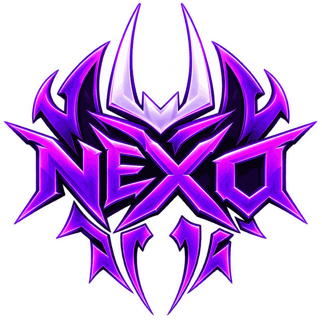

# ⚡ NEXO Hub — Blox Fruits Script

<p align="center">
  
  <br>
  <b>Custom Dark Neon Violet UI for Blox Fruits</b>
  <br>
  <i>Support Sea 1, Sea 2 & Sea 3 | Fast, Stable & Safe</i>
</p>

---

## 🚀 របៀបប្រើប្រាស់ (Quick Script)

ចម្លងកូដខាងក្រោមយកទៅ Paste ក្នុង Executor របស់អ្នក៖

```lua
loadstring(game:HttpGet("https://raw.githubusercontent.com/pik-bunheng/NEXO-Hub/main/nexo.lua?v=" .. tick()))()
```

---

## ✨ មុខងារសំខាន់ៗ (Key Features)

* 🌾 **Auto Farm Level:** ទទួល Quest និងវាយបិសាចស្វ័យប្រវត្តិ (Sea 1, 2, 3)
* ⚔️ **Auto Farm Boss / Materials:** ប្រមូលរបស់របរ និងវាយ Boss លឿន
* 🛡️ **Safe Mode:** មុខងារ Safe Hover ហោះវាយលើអាកាស មិនងាយស្លាប់
* 👥 **Auto Choose Team:** ជ្រើសរើស Pirates ឬ Marines ដោយស្វ័យប្រវត្តិ
* 🏪 **Shop & Stats:** ទិញ Melee, Swords, Haki, និង Redeem Codes ស្វ័យប្រវត្តិ
* 🌊 **Sea Events & Raids:** ជួយសម្រួលការធ្វើ Raid និង Sea Events ផ្សេងៗ
* 🎨 **Modern Neon Theme:** រចនាបថពណ៌ស្វាយ Neon Violet ស្អាត និងមិន Lag

---

## ⌨️ គ្រាប់ចុចបញ្ជា (Keybinds)

* **RightShift:** បើក / បិទ Menu (Toggle GUI)
* **Drag Logo:** អាចអូសទាញ Logo ផ្លាស់ប្តូរទីតាំងលើអេក្រង់បានតាមចិត្ត

---

## 📱 កម្មវិធី Executor ដែលគាំទ្រ (Supported Executors)

គាំទ្រទាំងលើ **PC** និង **Mobile (Android / iOS)**៖
* Delta
* Fluxus
* Codex
* Arceus X
* Cryptic
* Hydrogen

---

<p align="center">
  Made with ❤️ by <b>NEXO Team</b>
</p>
